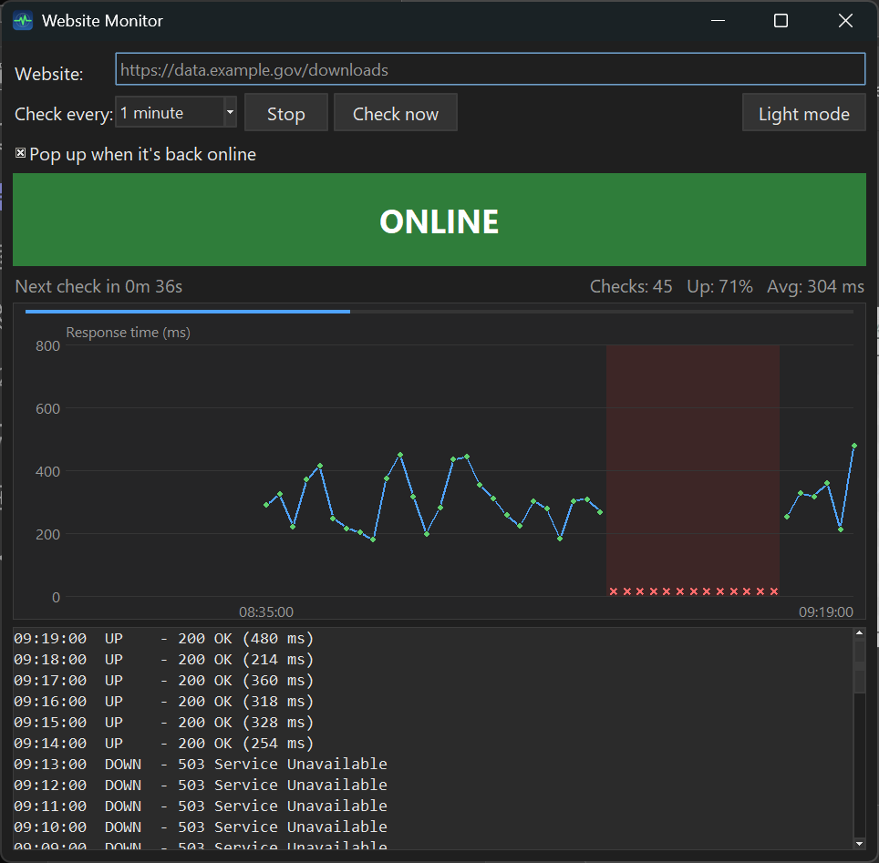

# Website Monitor

A small Windows desktop tool that watches a website and tells you the moment it comes back online.

Built for a simple, annoying problem: you need to download data from a site whose server is down, and you don't want to sit there hitting refresh. Enter the address, pick how often to check, press **Start**, and get on with your day. When the site starts responding again, Website Monitor plays a sound, jumps to the front of your screen and pops up a message.

## Features

- **Automatic checks** every 30 seconds up to every 60 minutes, or on demand with **Check now**
- **Big ONLINE / DOWN status** you can read from across the room
- **Back-online alert**: sound, notification pop-up and window brought to the front (only when the site actually goes from down to up)
- **Live graph** of response times for the last 60 checks, with outages shown as red bands, plus a countdown bar to the next check
- **Stats at a glance**: total checks, % of checks that were up, average response time
- **Log** of every check with the time and the server's answer (e.g. `200 OK`, `503 Service Unavailable`, `Timed out`)
- **Dark mode** (including the Windows title bar)
- **Remembers** your last website, interval, theme and window size
- **Nothing to install** if you have ArcGIS Pro, since it runs on the Python that ships with it

## Requirements

- Windows 10 or 11
- **ArcGIS Pro** installed (the tool uses its bundled Python, which already includes everything needed)

Using a different Python instead? Any Python 3.8+ with Tkinter works. Just run `pythonw website_monitor.py`. Pillow is only needed if you want to regenerate the icon.

## Getting started

1. Download or clone this repository and keep all the files together in one folder.
2. Double-click **`Run Website Monitor.bat`**.
3. Type the website address, choose an interval and press **Start**.

You can minimize the window and leave it running. It keeps checking in the background.

### Optional: a desktop shortcut with the app icon

Right-click your desktop → **New → Shortcut** and use:

| Field | Value |
|---|---|
| Location | `"C:\Program Files\ArcGIS\Pro\bin\Python\envs\arcgispro-py3\pythonw.exe" "<folder>\website_monitor.py"` |
| Name | `Website Monitor` |

Then right-click the shortcut → **Properties → Change Icon…** and select `website_monitor.ico`. Replace `<folder>` with wherever you saved the project. Launching this way also skips the brief console window the `.bat` shows.

## How "up" and "down" are decided

Each check requests the page with a 30-second timeout.

| Result | Status |
|---|---|
| Any response below HTTP 500 (`200 OK`, redirects, `403`, `404`, …) | **Online**: the server is answering |
| HTTP 5xx (`500`, `502 Bad Gateway`, `503 Service Unavailable`, `504`, …) | **Down**: typical of a server that is crashed, overloaded or in maintenance |
| No response within 30 s, connection refused, or address not found | **Down** |

## Files

| File | What it is |
|---|---|
| `website_monitor.py` | The app |
| `Run Website Monitor.bat` | Double-click launcher (finds ArcGIS Pro's Python automatically) |
| `website_monitor.ico` | App icon (window, taskbar, shortcut) |
| `make_icon.py` | Script that draws the icon; edit and run it to change the design |
| `website_monitor_settings.json` | Created on first close to store your preferences (not committed) |
